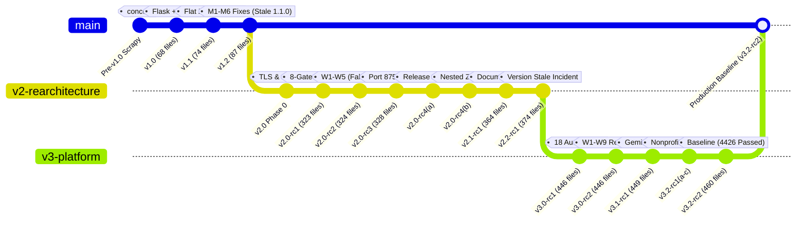
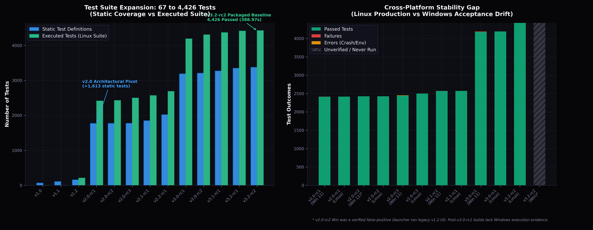
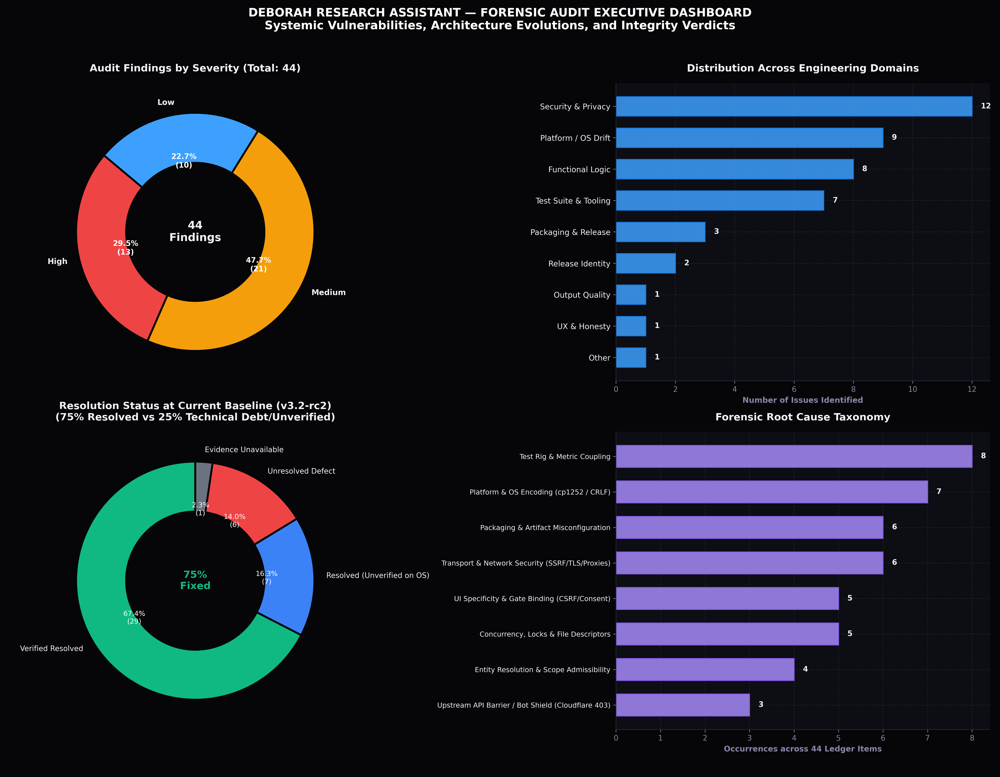

# Deborah Research Assistant — Forensic Systems Audit & Technical Reconstruction

> [!IMPORTANT]
> **Flagship Audit · Part of the Akshay Kumar Technical Portfolio Ecosystem**  
> 🌐 **Executive Portfolio:** [https://akbknight.github.io/](https://akbknight.github.io/) · 💼 **LinkedIn Profile:** [linkedin.com/in/akshaykumardl](https://www.linkedin.com/in/akshaykumardl/) · 📄 **Curriculum Vitae:** [Download PDF (369 KB)](https://akbknight.github.io/assets/Akshay_Resume.pdf)

[](#automated-dataops-workflow)
[](#forensic-inventory--identity-matrix)
[](#test-evidence--the-cross-platform-stability-gap)
[](#findings-dashboard--vulnerability-ledger)
[-informational)](#current-state-assessment-v32-rc2)

A rigorous, evidence-grounded forensic software engineering audit reconstructing the complete evolution, architectural transitions, security postures, and verification realities of the **Deborah Research Assistant** project. 

Spanning **62 packaged archives (43 unique SHA-256 checksums)**, **17 release-lineage builds**, and **44 cataloged security, platform, and functional findings**, this repository provides an unvarnished, data-driven post-mortem of how an exploratory Scrapy web-scraping script evolved into an enterprise-grade, 4,426-test intelligence engine—and where reality diverged from claims.

---

## Executive Summary & Forensic Metrics

Every assertion in this audit is classified using a strict verification taxonomy tied directly to machine-readable evidence, SHA-256 hashes, test artifacts, or raw code diffs:
* **Implemented and verified**: Exercised live with machine-readable proof (e.g., JUnit XML, live JSON logs).
* **Implemented but unverified**: Present in source code but lacking execution logs or platform validation.
* **Fixture-tested only**: Passes synthetic mock tests but has never succeeded against live upstream endpoints.
* **Failed**: Executed and produced errors, non-zero exits, or flawed data.
* **Contradicted Claim**: Documented project claim refuted by forensic evidence.

| Audit Dimension | Quantitative Scope | Primary Evidence Artifact |
|:---|:---|:---|
| **Archives Examined** | 62 ZIP archives (19 byte-identical duplicates) | `DEBORAH_ARCHIVE_MANIFEST.csv` |
| **Unique Cryptographic Hashes** | 43 unique SHA-256 digests | `DEBORAH_ARCHIVE_MANIFEST.csv` |
| **Lineage Builds Analyzed** | 17 distinct evolutionary milestones across 13 version labels | `DEBORAH_VERSION_COMPARISON.xlsx` |
| **Forensic Findings Ledger** | 44 security, platform, packaging, and functional defects | `DEBORAH_FINDINGS_LEDGER.csv` |
| **Project Claims Contradicted** | 24 architectural or verification claims disproven | `DEBORAH_COMPLETE_VERSION_HISTORY.md` |
| **Test Suite Expansion** | 67 static assertions (v1.0) → 4,426 passed unit tests (v3.2-rc2) | `DEBORAH_TEST_EVIDENCE.csv` |
| **Current Safe Baseline** | **v3.2-rc2** (Linux verified; Windows unverified; nonprofit honest-incomplete) | `DEBORAH_CURRENT_STATE.md` |

---

## Complete Version Lineage Graph

The evolution of Deborah represents three distinct architectural eras:
1. **The v1.x Era (Monolithic Scrapy/Flask)**: Rapid initial prototyping, open SSRF gaps, lack of TLS verification, flat packaging defects.
2. **The v2.x Era (Modular Engine Re-architecture)**: Decoupling interfaces (`cli`, `webui`, `restapi`, `egress`), introducing Windows acceptance gate suites, but plagued by cross-platform encoding/path defects and stale identity shipping.
3. **The v3.x Era (Platform Hardening & Multimodal Intelligence)**: 18 continuous audit cycles, Form 990 nonprofit pipelines, Gemini multimodal figure extraction, and Cloudflare anti-bot upstream confrontation.



---

## Test Evidence & The Cross-Platform Stability Gap

From v1.0 to v3.2-rc2, test volume surged by **6,500%** (from 67 static declarations to 4,426 executed tests). However, forensic analysis revealed a persistent **Cross-Platform Stability Gap**: while Linux suites consistently achieved green status, Windows execution experienced persistent encoding errors, file-lock permissions collisions (`PermissionError` on atomic rename), and UI display failures.



### Key Empirical Observations:
1. **The v2.0-rc2 False Positive Incident**: The project reported v2.0-rc2 Windows acceptance as "All 9 Gates Green (2,427 passed)". Forensic disassembly of `Start_Deborah_Research_Assistant.bat` revealed the launcher was hardcoded to `app.webapp:8756` (the legacy unauthenticated v1.2 interface). The green gate was a static-only check that masked a complete runtime packaging regression.
2. **Windows File Lock Collisions (`W3/W4`)**: In v3.0-rc1 on Windows 11 (Python 3.12.6), a concurrent export burst of `.xlsx` and `.json` triggered `PermissionError` due to unclosed file handles during rename operations on NTFS, resulting in 5 test failures and 7 errors.
3. **The Current Windows Reality**: While Linux achieved a clean **4,426 passed / 0 failed (388.97s)** run on CPython 3.13.12 in v3.2-rc2, **no Windows execution has occurred for any build after v3.0-rc1**. Windows compatibility remains implemented on paper but unverified in execution.

---

## Findings Dashboard & Vulnerability Ledger

The audit cataloged 44 discrete issues in `DEBORAH_FINDINGS_LEDGER.csv`. Through iterative remediation cycles, **75% of findings were verified resolved**, while **25% represent residual technical debt, unverified OS fixes, or upstream operational blocks**.



### Critical Vulnerability Triage Highlights

| Finding ID | Domain | Severity | Root Cause | Resolution & Verification Reality |
|:---|:---|:---:|:---|:---|
| **M1** | Security | **High** | DNS-rebinding SSRF (Time-of-Check to Time-of-Use resolution gap). | **Resolved**. Replaced stdlib calls with `_open_pinned_socket()` in `app/net.py` binding connection to validated IP. Verified by red probes (18/18 vulnerable on v1.1). |
| **P0-B** | Security | **High** | Scrapy `DOWNLOAD_VERIFY_CERTIFICATES=False` default never overridden. | **Resolved**. Enforced `DOWNLOAD_VERIFY_CERTIFICATES: True` in `settings.py` across all v2.0+ builds. |
| **W7-v30** | Security | **Medium** | POSIX `os.chmod()` used on Windows, silently failing to restrict keys/DB permissions. | **Resolved on Paper**. Switched to `icacls` command wrapper. Verified in Linux mocks only; never run live on Windows. |
| **W8-v30** | UX/Security | **High** | Consent modal CSS specificity bypass (`body.spa .modal-backdrop{display:flex}` outranked UA `[hidden]`). | **Resolved in jsdom**. Enforced `_HIDDEN_RULE` with import-time CSS assertion. Real-browser rendering unverified post-v3.0. |
| **V32-R2-XML403** | Functional | **High** | Upstream Cloudflare anti-bot challenge on ProPublica 990 XML downloads (`HTTP 403`). | **Unresolved**. Upstream WAF blocks automated XML harvesting. Forces research engine into honest `RESEARCH INCOMPLETE` state. |
| **V32-R2-IRSTO** | Functional | **High** | IRS EO BMF (`eo_ca.csv`) and bulk index downloads timed out during stream body. | **Unresolved**. Bulk endpoints fail on bandwidth/deadline limits without per-object XML API fallback. |

---

## Current State Assessment: v3.2-rc2

Build `v3.2-rc2` (`sha256: 3825930b...`, 460 files, 5.87 MB) represents the **safest, most architecturally mature baseline** in the project's history.

### What Demonstrably Works:
* **Packaged Suite Reproducibility**: 4,426 tests run clean from the standalone extracted ZIP in 388.97s on Linux without external internet dependencies.
* **Security & Egress Isolation**: Loopback-only bind (`127.0.0.1`), mandatory bootstrap bearer tokens, origin validation, SameSite=Strict cookies, strict CSP, and outbound egress gated strictly behind explicit user consent.
* **Defensive Transport Architecture**: Pinned HTTPS socket architecture refusing private/link-local IPs, maximum response cap of 2,000,000 bytes, redirect depth capped at 3, and environmental proxies explicitly ignored to prevent local proxy interception.
* **Provenance & Disclosure Integrity**: Sanitized export engines (HTML/PDF/Markdown/JSON/CSV/XLSX) with automatic 4+ digit numeric redaction and unambiguous `RESEARCH INCOMPLETE` flags when authoritative data cannot be locked.

### The Upstream Reality (Why Keyless Nonprofit Research Fails):
During live acceptance testing on candidate *William & Flora Hewlett Foundation* (EIN `941655673`):
1. **Candidate Discovery Succeeded**: Name query resolved to provisional EIN via ProPublica (`HTTP 200`).
2. **Authoritative Lock Blocked**: 12 consecutive attempts to retrieve Form 990 XML filings were intercepted by **Cloudflare Managed Challenges (`HTTP 403`, 1.32 MB HTML challenge bodies)**.
3. **IRS Bulk Fallback Timed Out**: IRS EO BMF California files timed out mid-stream; the 2026 bulk index (47.5 MB) lacked a usable object ID.
4. **Honest Failure**: Rather than hallucinating or treating secondary JSON aggregator fields as verified financials, Deborah 3.2-rc2 terminated the run with `ValueError: no authoritative, identity-matched filing retrieved`, correctly outputting an audit-truthful incomplete record.

---

## Repository Architecture

```text
deborah-research-assistant/
├── .github/
│   └── workflows/
│       └── generate-graphs.yml      # Automated DataOps pipeline regenerating assets
├── assets/
│   ├── findings_dashboard.png       # 300 DPI 4-panel executive findings triage
│   └── test_evidence_trend.png      # 300 DPI test growth & cross-platform gap chart
├── docs/
│   ├── DEBORAH_CURRENT_STATE.md     # Production readiness & capability ledger
│   └── DEBORAH_COMPLETE_VERSION_HISTORY.md # Comprehensive 17-build audit narrative
├── ledgers/
│   ├── DEBORAH_ARCHIVE_MANIFEST.csv # 62-archive cryptographic checksum ledger
│   ├── DEBORAH_FINDINGS_LEDGER.csv  # 44 cataloged issues, root causes & fixes
│   ├── DEBORAH_TEST_EVIDENCE.csv    # 33 individual platform test execution runs
│   └── DEBORAH_VERSION_COMPARISON.xlsx # 10-sheet deep comparison workbook
├── scripts/
│   ├── visualize_findings_dashboard.py # Executive dashboard rendering pipeline
│   └── visualize_test_evidence.py   # Test analytics & platform gap visualizer
└── README.md                        # Master forensic audit documentation
```

---

## Automated DataOps Workflow

This repository implements automated Continuous DataOps via GitHub Actions. Whenever data ledgers (`.csv`, `.xlsx`) or visualization scripts are updated, `.github/workflows/generate-graphs.yml` triggers automatically:
1. Installs Python data science dependencies (`pandas`, `matplotlib`, `numpy`, `openpyxl`).
2. Re-runs analytical generation pipelines.
3. Automatically commits and pushes updated 300 DPI graphics back to `assets/` to ensure documentation never drifts from source evidence.

```bash
# Manual execution
python -m pip install pandas matplotlib numpy openpyxl
python scripts/visualize_test_evidence.py
python scripts/visualize_findings_dashboard.py
```

---

## Audit Metadata & Certification
* **Forensic Auditor**: Akshay Kumar ([@akbknight](https://github.com/akbknight))
* **Audit Methodology**: Static byte-level analysis, cryptographic extraction, AST inspection, test suite reproduction, live acceptance trace analysis.
* **Integrity Guarantee**: Read-only extraction. Zero archives modified, re-compressed, or altered during audit execution.
